<h1 align="center">A Link to the Past 3DS</h1>

<p align="center">
  <strong>Return to Hyrule. Keep the map close.</strong><br>
  A Link to the Past, adapted for two Nintendo 3DS screens.
</p>

<p align="center">
  <a href="#download-and-installation">Download</a> ·
  <a href="#features">Features</a> ·
  <a href="#screens">Screens</a> ·
  <a href="#stereoscopic-3d">3D</a> ·
  <a href="#walkthrough-on-the-bottom-screen">Guide</a> ·
  <a href="#documentation">Documentation</a> ·
  <a href="CHANGELOG.md">Changelog</a> ·
  <a href="#community-and-bug-reports">Community</a>
</p>

<p align="center">
  <a href="https://github.com/EstebanPdN/zelda-alttp-3ds/releases/tag/v3.2"></a>
  <a href="#download-and-installation"></a>
  <a href="#updates"></a>
  <a href="#license-and-legal-notice"></a>
</p>

<p align="center">
  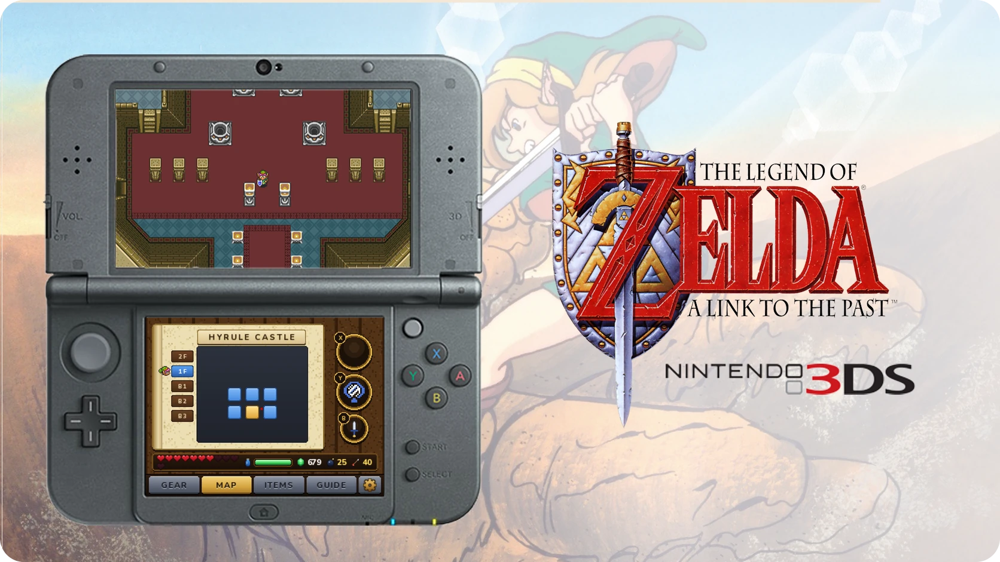
</p>

<p align="center">
  <a href="https://estebanpdn.github.io/"></a>
  <a href="https://discord.gg/BjbzfRYpV"></a>
</p>

Nintendo 3DS dual-screen port of Zelda3.

This project was developed with the help of [OpenAI Codex](https://openai.com/codex/) and [Claude Code](https://claude.com/product/claude-code). Learn more about the development process [here](AI_DEVELOPMENT.md).

This project is based on open-source work from:

- Original reverse-engineered Zelda3 engine: https://github.com/snesrev/zelda3
- Android port base: https://github.com/Waterdish/zelda3-android
- Dual-screen Android branch used as the 3DS source base:
  https://github.com/samyost1/zelda3-android

No ROM or extracted game asset package is distributed in this repository. Each
user must provide their own legally obtained USA, unheadered ROM on their own
3DS SD card.

## Features

<table>
  <tr>
    <td width="50%" valign="top"><strong>Return to Hyrule</strong><br>A native dual-screen adaptation based on Zelda3 and its Android ports.</td>
    <td width="50%" valign="top"><strong>Made for two screens</strong><br>400×240 gameplay above; maps, items, gear, a walkthrough and settings below, in a wood-and-parchment style.</td>
  </tr>
  <tr>
    <td width="50%" valign="top"><strong>Choose your view</strong><br>Wide, stretched and original presentation, with persistent per-ROM settings and turbo options.</td>
    <td width="50%" valign="top"><strong>Keep it current</strong><br>Stable / Pre-release updates, on-device ROM extraction and quick diagnostic checkpoints.</td>
  </tr>
  <tr>
    <td width="50%" valign="top"><strong>See Hyrule in 3D</strong><br>Stereoscopic depth on Old 3DS and 3DS XL: ledges and cliffs rise, statues and trees stand up from the ground.</td>
    <td width="50%" valign="top"><strong>Guide in hand</strong><br>Read your own walkthrough on the bottom screen, with chapters, places and drag scrolling.</td>
  </tr>
</table>

### Feature details

- Top screen: 400x240 gameplay.
- Bottom screen: 320x240 live map, dungeon map, gear view, item selection,
  walkthrough and touch settings, styled after A Link Between Worlds: wood
  frame, parchment panels, gold X/Y/B slots and a status bar with hearts,
  magic, rupees, bombs, arrows and keys on every page.
- First launch extracts `zelda3_assets.dat` locally from the user's ROM.
- Display modes: wide mod, stretched original and original aspect.
- Turbo speed: off, x2, x3, x4 or x5.
- New 3DS: ZL or C-stick can hold turbo when turbo is enabled.
- Quick diagnostics: press `L + R + A` to create a dump with memory files,
  physical 400x240/320x240 screen captures, raw display framebuffers and a
  validated `load-state.bin` checkpoint. Audio pauses during capture and a
  `DUMP SAVED` notice confirms complete success on the top screen.
- Developer settings can load the newest dump checkpoint for the active ROM
  profile and optionally show the current FPS on the top screen.
- PICA200/Citro2D presentation for both screens with nearest-neighbor sampling
  and RGB565 display output.
- PICA200 GPU rendering on Old 3DS, with automatic software fallback for
  unsupported effects. New 3DS uses its existing CPU renderer.
- Stereoscopic 3D on Old 3DS and 3DS XL: the 3D slider sets the depth, and
  Settings > Screen > 3D DEPTH picks OFF, LOW, MID or HIGH.
- 3D depth follows the terrain: ledges, cliffs and stairs give the ground its
  height, objects stand up from their own base, and sprites stand on the
  ground under their feet. The terrain is solved on the second CPU core.
- GUIDE tab: a walkthrough from the SD card with chapter and place buttons,
  drag scrolling, a draggable scrollbar and the reading position saved per
  profile.
- Native 400x240 WIDE mode, fixed-camera edge corrections and persistent
  per-ROM display, zoom, turbo and control settings.
- Responsive map controls and independent heart updates on Old 3DS.
- Fixed-step 60 Hz gameplay timing with bounded catch-up instead of making
  game speed depend on when a VBlank wait returns.
- Parallel PPU scanline rendering on Core 0 and Core 1, plus Core 2 on New 3DS,
  with persistent tile-row caches and frame-time diagnostics in quick dumps.
- HOME Menu banner uses a lightweight custom CGFX 3D logo model with the
  supplied hover sound converted to a short PCM WAV.

## Screens

The bottom screen, rendered by the same interface code as on the console.

<table>
  <tr>
    <td width="50%" align="center">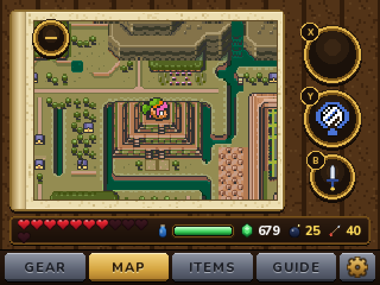<br><sub>Overworld map</sub></td>
    <td width="50%" align="center">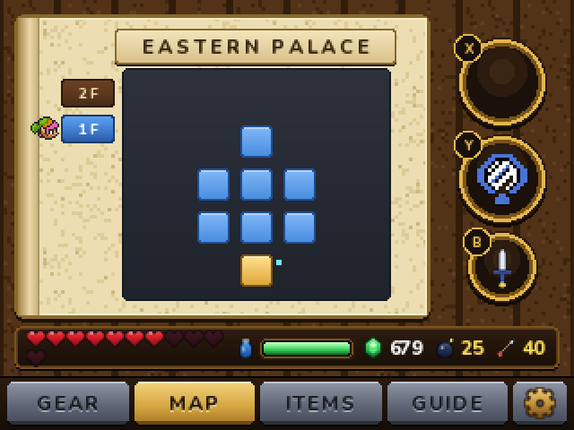<br><sub>Dungeon map</sub></td>
  </tr>
  <tr>
    <td width="50%" align="center">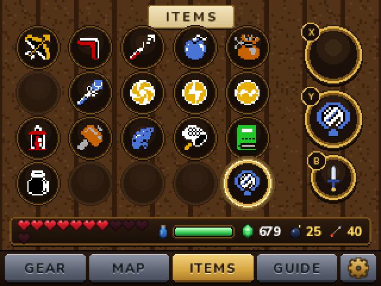<br><sub>Items: tap one to equip it</sub></td>
    <td width="50%" align="center">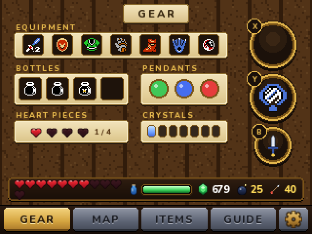<br><sub>Gear</sub></td>
  </tr>
</table>

## Stereoscopic 3D

<p align="center">
  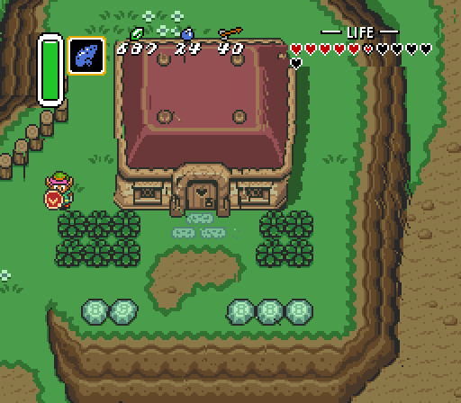
  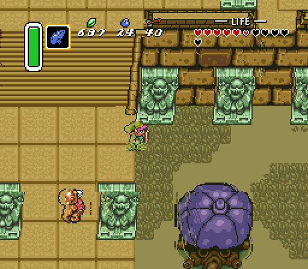
</p>
<p align="center"><sub>Left and right eye from console dumps. The depth is exaggerated so it shows on a flat screen.</sub></p>

3D works on Old 3DS and Old 3DS XL, where the PICA200 GPU draws each frame
twice. New 3DS and 2DS stay in 2D.

1. Open Settings > Screen and set **3D DEPTH** to LOW, MID or HIGH.
2. Raise the 3D slider.

The HUD stays on the screen plane. With **3D TERRAIN** on (Settings > Developer,
on by default), depth comes from the game's own collision data: plateaus,
ledges and stairs sit at different heights and sprites stand on the ground.
Turn it off for the simpler depth by background layer.

On an Old 3DS XL outdoors with 3D on, the game ran at 45 fps with 3D TERRAIN
off and 40 fps with it on.

<table>
  <tr>
    <td width="50%" align="center">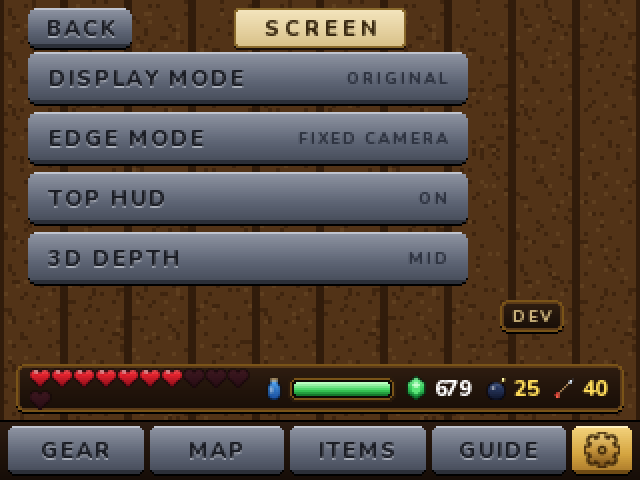<br><sub>Settings > Screen > 3D DEPTH</sub></td>
    <td width="50%" align="center">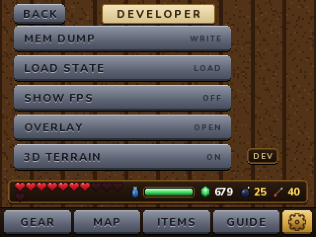<br><sub>Settings > Developer > 3D TERRAIN</sub></td>
  </tr>
</table>

## Walkthrough on the bottom screen

The GUIDE tab reads `sdmc:/3ds/Zelda 3DS/guide.txt`. No walkthrough is
included, because guides belong to their authors. Make your own copy from a
plain-text GameFAQs walkthrough:

```sh
python3 tools/secondscreen/make_guide.py FAQ.txt guide.txt --author "Devin Morgan" --no-toc Overworld
```

Copy `guide.txt` to `sdmc:/3ds/Zelda 3DS/`, next to your ROM. The converter
was built and tested with Devin Morgan's FAQ/Walkthrough. Other walkthroughs
whose chapter headings look like `-= 5. Walkthrough -=` should also work.

- **CONTENTS** lists the chapters. Tap one for its places, then tap a place to
  jump there.
- Drag the text to scroll, tap the upper or lower half to turn a page, or drag
  the scrollbar.
- Your reading position is saved per profile.

<table>
  <tr>
    <td width="33%" align="center">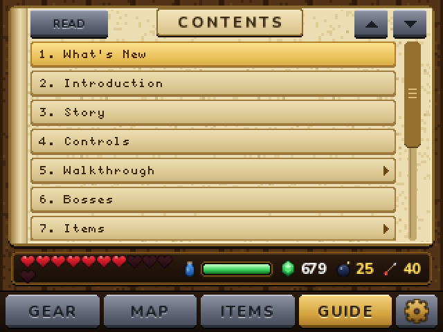<br><sub>Chapters</sub></td>
    <td width="33%" align="center">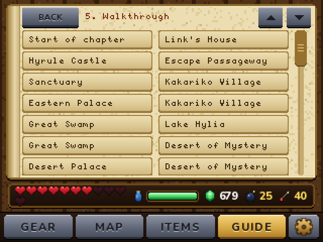<br><sub>Places</sub></td>
    <td width="33%" align="center">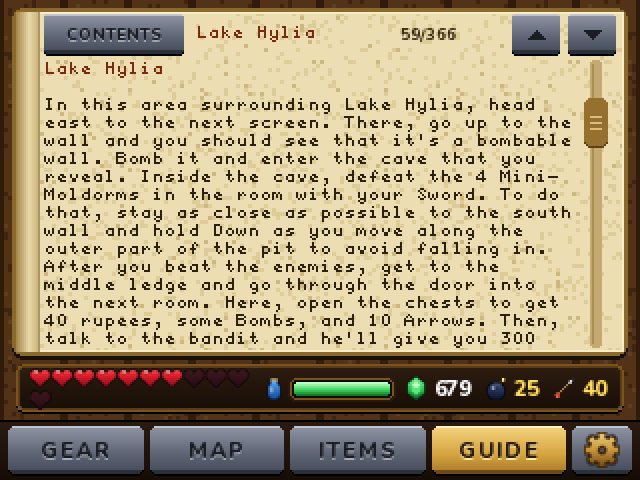<br><sub>Reading</sub></td>
  </tr>
</table>
<p align="center"><sub>Walkthrough text in the screenshots: Devin Morgan's FAQ/Walkthrough from GameFAQs.</sub></p>

<a id="installation"></a>

## Download and installation

<p>
  <a href="https://github.com/EstebanPdN/zelda-alttp-3ds/releases/download/v3.2/zelda3-3ds-v3.2.cia"></a>
  <a href="https://github.com/EstebanPdN/zelda-alttp-3ds/releases/download/v3.2/zelda3-3ds-v3.2.3dsx"></a>
</p>

**Stable: [v3.2](https://github.com/EstebanPdN/zelda-alttp-3ds/releases/tag/v3.2).**

Install the CIA, then create this directory on the SD card:

```text
sdmc:/3ds/Zelda 3DS/
```

Place a legally obtained USA, unheadered ROM there. The preferred filename is
`zelda3.sfc`, but the setup also accepts other `.sfc` or `.smc` filenames.

On first launch, press A to validate the ROM and extract the assets. The ROM is
read locally and is never copied into the CIA.

If you’re using a translated/patched ROM, put both the clean USA ROM and the patched ROM in `sdmc:/3ds/Zelda 3DS/`.

The port should use the clean ROM for the original assets and the patched ROM for the translated text. Translation patches may work this way, but gameplay hacks are not guaranteed to be compatible.

Audio requires:

```text
sdmc:/3ds/dspfirm.cdc
```

Luma3DS can create this file from the console's own firmware through Rosalina's
`Dump DSP firmware` command.

## Releases

Every GitHub release includes:

- installable CIA
- Homebrew Launcher 3DSX
- QR code for scanning the CIA URL from FBI on a 3DS

GitHub supplies automatic source-code archives for each tag.
The release page shows the QR code, a short changelog and bug-report instructions.
Detailed development notes are preserved inside the source snapshot.

Latest stable release: [v3.2](https://github.com/EstebanPdN/zelda-alttp-3ds/releases/tag/v3.2)

See [CHANGELOG.md](CHANGELOG.md) for the changes since v2.8.

## Bug reports

Press `L + R + A` while the issue is visible and attach the resulting dump from:

`sdmc:/3ds/Zelda 3DS/dumps/`

## Documentation

- [Repository map and maintenance conventions](docs/REPOSITORY.md)


| Guide | Purpose |
| --- | --- |
| [3DS controls and diagnostics](platform/3ds/README.md) | Platform setup, input and bug-report captures. |
| [Updates](#updates) | Channels, release notes, installation and restart behavior. |
| [Building](#building) | Toolchain, SDL2 source and CIA packaging. |
| [Changelog](CHANGELOG.md) | Version history and changes. |

## Building

Requirements:

- devkitARM, libctru and 3ds-cmake under `DEVKITPRO`
- `makerom` and `bannertool` for CIA packaging
- the vendored SDL2 source in `third_party/SDL2`
- `banner.cgfx` is prebuilt in `platform/3ds/assets`; it was generated from
  the supplied 2.0 Blender logo model.

Build:

```sh
chmod +x platform/3ds/build.sh
platform/3ds/build.sh
```

The script builds the 3DSX and CIA under `build-3ds/game/`.

## License and legal notice

The Zelda3 engine retains the **MIT license** and copyright notices in
[engine/LICENSE.txt](engine/LICENSE.txt), which also contains the Opus notice.
SDL2, SDL2_mixer and other dependencies retain their own licenses. These
component licenses do not grant rights to Nintendo game content.

The bottom-screen label font is baked from Nunito (SIL Open Font License 1.1).
The guide font is the public-domain X11 misc-fixed 6x9 face.

This repository contains only source code, build scripts, redistributable port
assets and patch/extraction logic. It does not include a ROM, extracted game
assets, or `zelda3_assets.dat`.

Users are responsible for providing their own legally obtained compatible ROM.

## Credits

Thanks to [@999sian](https://github.com/999sian) for her Old 3DS optimization
work, [arth78](https://github.com/arth78) for the WIDE display contribution,
and [Archaistic](https://github.com/Archaistic) for the WIDE height and
Triforce improvements.

3D Banner work by [Phibonacci](https://github.com/Phibonacci), based on the 3D
model by [TiraArt](https://sketchfab.com/TiraArt).

Stereoscopic 3D, terrain depth, the bottom-screen restyle and the GUIDE tab by
[djaysan](https://github.com/djaysan).

See [3DS controls and diagnostics](platform/3ds/README.md).

## Updates

In Settings > Update, choose Stable or Pre-release. Tap the release name to
read its changelog on the top screen, with Prev/Next below for more pages.
Choose Download Update and confirm installation, then reopen the game.
Save in-game before installing. Startup checks also indicate newer releases.

Version [v3.2](https://github.com/EstebanPdN/zelda-alttp-3ds/releases/tag/v3.2)
is the latest stable release. Select the Stable channel to install it. It fixes Restart retaining stale game RAM after ROM
reselection, which could leave gameplay black and silent. It also batches updater
SD transfers and prevents downloads from being starved by rendering.

Settings is Screen, Turbo Speed, Developer, Update, Restart. Restart opens
the ROM selector and starts the selected ROM fresh; existing saves remain.

Version 3.1 uses the native HID contact flag for touch press and release detection,
including startup and releases with residual coordinates. Physical coordinates
remain protected from SDL viewport transforms. The last 32 touch selections
are included in diagnostic dumps. Use the FBI QR if touch controls prevent
opening Update.

## Community and bug reports

[Join the project Discord](https://discord.gg/BjbzfRYpV) for updates, testing,
suggestions and support. Use [GitHub issues](https://github.com/EstebanPdN/zelda-alttp-3ds/issues)
for reproducible reports, including your version, console model and steps to
reproduce the problem. Review diagnostic captures before sharing them.

---

<p align="center">
  <a href="https://estebanpdn.github.io/">Esteban’s Forge</a> ·
  <a href="https://discord.gg/BjbzfRYpV">Discord</a> ·
  <a href="#documentation">Documentation</a> ·
  <a href="#license-and-legal-notice">License and notices</a><br>
  <sub>An independent fan project. Game names and content belong to their respective owners.</sub>
</p>
